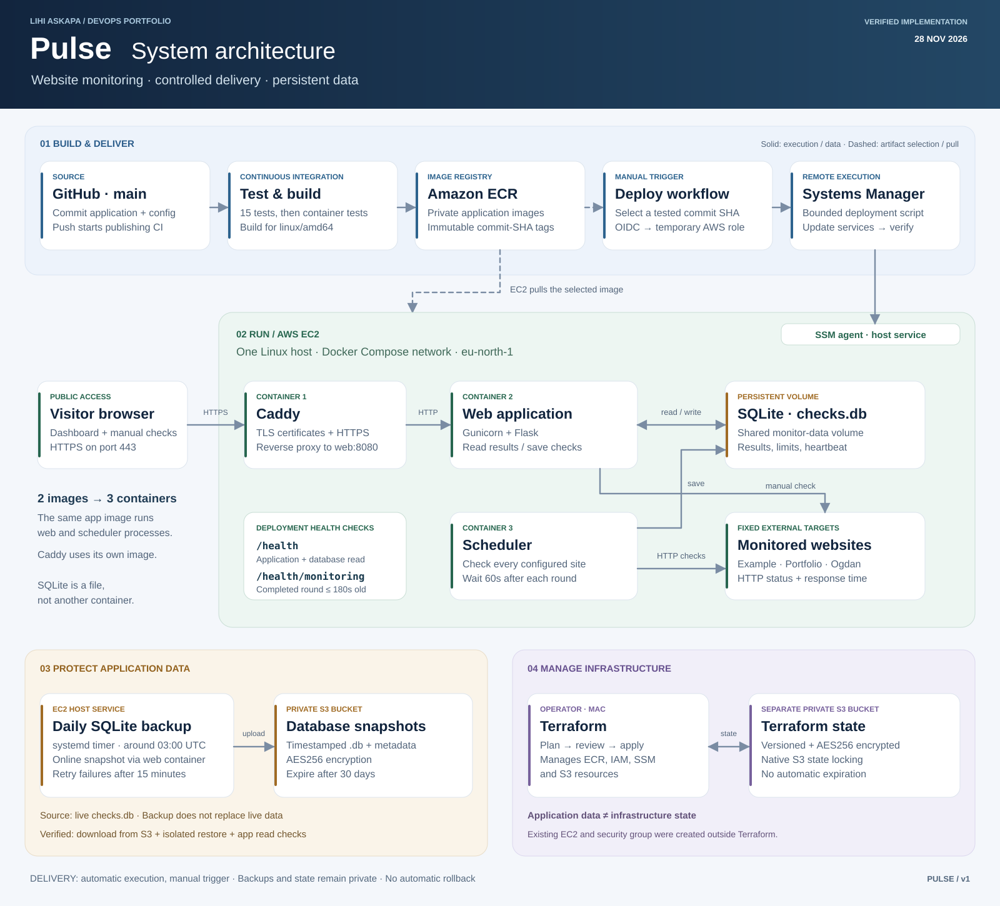

# Pulse — Mini Uptime Monitor

A small DevOps learning project by **Lihi Askapa**: build it, explain it, break it, investigate it.

**[Open the live demo](https://pulse-13-60-191-46.sslip.io/)** — hosted on AWS EC2
with Docker Compose and Caddy HTTPS. Checks are limited to three configured sites;
manual checks share a 30-second per-target cooldown. Refresh to see scheduled results.
This learning demo is available while the EC2 server is running; its IP-based
hostname may change after a server stop/start.

## Architecture

[](docs/architecture.md)

[Architecture and concise explanations](docs/architecture.md)

## Project planning and context

- [Project plan](docs/PLANNING.md): completed stages, upcoming work and completion criteria.
- [Terraform state](docs/terraform-state.md): private versioned S3 storage, locking and recovery.
- [Project context](docs/CONTEXT.md): architecture, environments, file responsibilities and where to resume.
- [Learning notes](docs/learning-notes.md): the chronological record of exercises and troubleshooting.

## Stage 1: local application

- Python + Flask, server-rendered HTML/CSS, SQLite.
- Check configured websites on demand; record HTTP status, duration and UTC timestamp.
- Display the latest result per target and the last 50 historical checks.
- `GET /health` checks this application and database readability, independently of target status.
- `GET /health/monitoring` checks the last completed scheduled round. It returns
  503 until a round completes, or when that completion is over 180 seconds old.
  Manual checks do not refresh this signal; target failures still count as
  completed checks. This is separate from Docker health to avoid a startup
  dependency cycle. A stopped optional scheduler will therefore report degraded.
  With a custom scheduler interval, adjust `MONITOR_MAX_AGE_SECONDS` in the app
  configuration to allow the interval plus the duration of a full round.
  This enhancement has 15 passing tests and was verified on EC2, including
  stopped-scheduler detection (503) and recovery (200).
- HTTP 200–399 is classified as up; other codes and connection failures as down. Redirects are followed by Python's HTTP client.
- Duration measures time to receive response headers, not complete page load.

## Run

Use Python 3.12 (as in Docker and CI). The single `requirements.txt` includes both
Flask and Gunicorn; do not use the Mac's older system Python for installation.

```bash
python3.12 -m venv .venv
source .venv/bin/activate
python -m pip install -r requirements.txt
python app.py
```

Open http://127.0.0.1:8080 and click **Check now**. Stop with Ctrl+C.

```bash
python -m unittest discover -s tests -v
curl http://127.0.0.1:8080/health
```

## Stage 2: Docker

```bash
docker compose up -d --build --wait
docker compose ps
```

Open http://127.0.0.1:8081. Docker runs Gunicorn as a non-root user and stores SQLite in a named volume. This history is separate from the local Python history. See the [Docker lab in Hebrew](docs/docker-lab.md) for ports, logs, persistence and troubleshooting.

## Stage 3: continuous integration

The workflow in [`.github/workflows/ci.yml`](.github/workflows/ci.yml) runs on pushes,
pull requests and manual requests from the GitHub Actions tab. An Ubuntu runner
downloads the repository, sets up Python 3.12, installs `requirements.txt` and runs
the same unittest tests used locally. The tests use mocked HTTP responses and
temporary databases; they do not check the live websites or use the application volume.

The workflow starts running after the file is committed and pushed to GitHub.
After the Python tests pass, it builds `mini-uptime-monitor:ci` and runs the same
tests inside a temporary container from that image. Successful main-branch runs
publish the tested `linux/amd64` image to the private ECR repository using GitHub
OIDC and a restricted IAM role. Tags identify the full commit SHA. Pull requests
and other branches run checks without publishing. Publishing does not deploy EC2.
See [the CI lab in Hebrew](docs/ci-lab.md).

The user verified publication and manually deployed image
`b13144f3ef327628849a377f409dfef02ce77a5d` on EC2. Its fifteen tests passed on the
server; public health returned 200 and scheduler logs showed completed rounds.
`compose.ecr.yaml` overrides web and scheduler images through required `APP_IMAGE`.
Use it after the base and public Compose files, with `--no-build`. The server's
instance role permits pulling only from the project repository. See
[the public deployment guide](docs/public-demo.md) for the command sequence.

## Optional scheduled monitoring

The `monitor` CLI command reuses the web button's check-and-save function. The
optional Compose service `scheduler` runs it in a separate container with the same
image and SQLite volume. It checks all configured targets sequentially, waits 60
seconds after the round finishes, then repeats. The first round starts immediately.
This is not an exact once-per-minute schedule. Refresh the browser to see new rows.

After rebuilding the image (see the Docker lab for the local offline build):

```bash
docker compose --profile monitoring up -d
docker compose logs --tail=20 scheduler
docker compose stop scheduler
```

The last command stops background checks while leaving `web` running. The scheduler
has no HTTP listener or Docker health check. The web endpoint `/health/monitoring`
reports its completed-round freshness. Run one scheduler
instance; there is no leader election or alerting. The public overlay enables
restart-unless-stopped policies; the base Compose configuration does not. Configure targets consistently in both services if
overriding defaults. A database failure stops the worker and is visible in its logs.
Stopping Docker stops monitoring. History has no retention limit yet; stop the
worker after the exercise.

## Configuration

| Variable | Default | Purpose |
|---|---|---|
| `PORT` | `8080` | Application listener |
| `HOST` | `127.0.0.1` | Local interface; later use `0.0.0.0` inside Docker |
| `DATABASE_PATH` | `data/checks.db` beside app.py | Persistent SQLite file |
| `REQUEST_TIMEOUT` | `5` | HTTP socket timeout in seconds, not a strict total request deadline |
| `MONITOR_TARGETS` | Example + portfolio + Ogdan Mehandesim | JSON mapping of target IDs to name/URL |

Example: `PORT=8081 python app.py`. `.env.example` is a reference; no automatic dotenv loader is used.

## Request path

Browser → Flask → configured website → SQLite → rendered result.

`POST /checks` accepts a configured target ID, not an arbitrary URL. Only configure endpoints you are permitted to check. Each click performs one synchronous request; optional background checks use the scheduler described above. There is no uptime percentage or alert delivery yet. The latest result is a historical observation, not a guarantee of present availability.

## Deployment boundary

The default configuration is a localhost learning application without authentication.
Direct `python app.py` uses Flask's development server; Docker uses Gunicorn with
local-only port publishing and resource limits. Do not expose the development server publicly.

The public demo configuration is defined in `compose.public.yaml` and
`Caddyfile`, with HTTPS, session form tokens and a shared 30-second per-target manual
check cooldown. Fifteen tests passed inside the current EC2 image. The user verified the public
HTTPS page, a successful manual check and rejection of a repeated check.
See [the public demo guide in Hebrew](docs/public-demo.md). This is a small demo,
without DDoS protection, automatic history retention or general-purpose URL input.

## Deployment automation preparation

SSM connectivity was verified on 2026-11-28. Terraform attaches the managed
SSM core policy to the EC2 role; a diagnostic command sent from the personal
AWS CLI returned Success and root. The separate GitHub deployment role and bounded SSM document were then created;
a manual invocation verified the current image and a fresh scheduler round.
The manual GitHub workflow successfully deployed another image and returned to
the previous compatible version. A push publishes an image but does not deploy it.

See [deployment instructions](docs/deployment.md) for the manual Actions trigger
and the difference between publishing, deploying and infrastructure updates.

## Learning roadmap

Version 1 covers the implemented and verified steps below. It remains a
single-host learning demo; deferred improvements are tracked separately.

- [x] Flask application, SQLite history, logs and 15 automated tests
- [x] Docker image, Compose services and persistent storage
- [x] CI failure investigation and repair
- [x] Scheduled checks and stale-scheduler detection/recovery
- [x] Public AWS EC2 deployment with Caddy HTTPS
- [x] Terraform-managed ECR, IAM, SSM and S3 resources
- [x] CI image publication to ECR using GitHub OIDC
- [x] Automated deployment with a manual trigger and compatible-image rollback
- [x] Daily SQLite backups to S3; first service execution and isolated restore verified
- [x] Encrypted, versioned Terraform remote state with locking verified
- [x] Architecture diagram and focused operational documentation

Future iterations:

- [ ] Automatic alert delivery and database history retention
- [ ] Stable public addressing and continued cost review
- [ ] Terraform adoption of existing EC2/network resources and reusable modules
- [ ] ECS evaluation and a deliberate shared-data design
- [ ] Database schema-migration recovery exercises

The scheduled-backup service was verified with an immediate execution; that does
not by itself establish that a future calendar-triggered run has fired.

See [learning notes](docs/learning-notes.md). Only completed stages should be described as hands-on experience in an interview.

## Backup and restore

A one-time online SQLite snapshot was created on 2026-11-28, downloaded from EC2
to the Mac and restored to an isolated file. Integrity, transfer checksum, all
restored SQL contents, dashboard rendering and application health were checked.
The live database was not replaced. Daily backups are now enabled on EC2 and
upload snapshots to private encrypted S3 storage with 30-day lifecycle expiration.
The first service run uploaded successfully, and its S3 copy passed isolated restore
checks. The timer runs around 03:00 UTC and retries failures after 15 minutes.
These are separate `.db` snapshots, not a continuously updated replica.
See [backup instructions and evidence](docs/backup-restore.md).

## Terraform state storage

Terraform now uses a dedicated private, encrypted and versioned S3 backend with
native S3 locking. Migration preserved all 24 managed resource records and outputs;
a follow-up plan showed no changes and a concurrent plan was blocked by the lock.
The state bucket has no expiration rule and is separate from daily SQLite backups.
See [state operations and recovery](docs/terraform-state.md). EC2 itself remains
outside Terraform management; the state covers only the resources in the configuration.
