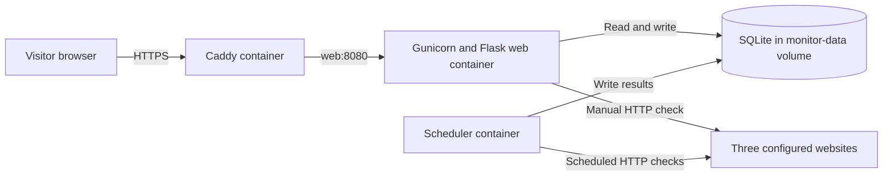

# Pulse project context

Last updated: 2026-11-28

Read this file when continuing work on Pulse. It records the current implementation, environment, learning preferences and exact continuation point. Use [PLANNING.md](PLANNING.md) for the roadmap and completion criteria, and inspect the actual code before changing behavior.

## Purpose and owner

Lihi Askapa is building a small DevOps portfolio and interview-preparation project. The application checks configured websites and records evidence about their availability. Learning to explain and operate the system is as important as adding features.

Work is AI-assisted and guided. Do not describe generated code or assisted steps as independent experience. Do not mix this personal project with Check Point work environments or customer information.

## Current state

| Area | Current state |
|---|---|
| Application | Flask app with a server-rendered dashboard and SQLite history. |
| Local containers | Web and optional scheduler, sharing one named data volume. |
| AWS deployment | Manually deployed on EC2, with Caddy providing public HTTPS. |
| CI | GitHub Actions tests Python code, builds the image and reruns tests in a container. |
| Tests | Fifteen test methods in `tests/test_app.py`; all passed locally, in green CI and in the pulled EC2 image. |
| CD | Manual GitHub workflow verified: cda4c66 deployed, then compatible-version rollback to b13144f succeeded. Pushes do not deploy. |
| Terraform | AWS provider 6.74.0; ECR, OIDC, publishing role, EC2 role/profile and SSM policy attachment applied. EC2 itself has not been imported. |
| ECR | Current manually deployed image: b13144f3ef327628849a377f409dfef02ce77a5d; fifteen tests passed on EC2. |
| SSM | Online; separate GitHub deployment role and bounded document version 1 verified in successful Actions runs. |
| ECS | Deferred by the user; continue CD on existing EC2 and Compose. |
| Latest recorded validation | On 2026-11-28, user confirmed scheduler-health failure/recovery and successful SSM command execution. This file is not a live health check. |

## Repository and environments

| Item | Value |
|---|---|
| Local repository on Mac | `/Users/lihias/Documents/Codex/mini-uptime-monitor` |
| GitHub repository | `https://github.com/lihi-askapa/mini-uptime-monitor` |
| Branch | `main` |
| Public demo | `https://pulse-13-60-191-46.sslip.io/` |
| Personal AWS account | `944464821297` |
| AWS region | `eu-north-1` — Stockholm |
| EC2 instance | `i-07451294bf374f84c`, named `mini-uptime-monitor` |
| Last confirmed public IP | `13.60.191.46` |
| EC2 operating system and size | Amazon Linux 2023, x86_64, t3.micro |
| Root disk | 16 GiB gp3, encrypted using `aws/ebs`; delete on termination enabled. |
| EC2 project directory | `/home/ec2-user/mini-uptime-monitor` |
| SSH key path on Mac | `~/.ssh/mini-uptime-monitor-key.pem`; never copy its contents into documentation or Git. |

The repository was created private. Confirm its current visibility before assuming portfolio visitors can read the code. The public application is separate from GitHub repository visibility.

SSH is restricted to Lihi's public source IP. That IP changed during the exercise and caused a connection timeout; updating the SSH source rule restored access. Recheck the current IP before changing the rule again. Ports 80 and 443 were opened for public web access.

The EC2 public IP may change after stop/start. Reconfirm it before copying commands or distributing the IP-based demo link. The last confirmed Free plan balance was an initial $100 credit allocation, not a current balance.

## Architecture

- `web` and `scheduler` use the same application image but different startup commands.
- `web` runs Gunicorn with one worker and four threads, listening on container port 8080.
- `scheduler` runs Flask's `monitor` CLI command, with a 60-second wait after each full round.
- Both mount `monitor-data` at `/app/data` and use `/app/data/checks.db`.
- Caddy reaches `web` over the Compose network. It does not read the application database.
- Public visitors connect to Caddy on port 443; HTTP on port 80 is redirected to HTTPS.
- Host port 8081 remains bound to loopback, not to all public interfaces.

## File responsibilities

Paths below are relative to the repository root.

| File | Responsibility |
|---|---|
| `app.py` | App factory, target configuration, database access, routes, shared check function and scheduler command. |
| `templates/index.html` | Render results and forms received from Flask; link to `/health`. |
| `static/style.css` | Dashboard presentation. |
| `requirements.txt` | Single dependency list: Flask 3.1.2 and Gunicorn 27.0.1. |
| `Dockerfile` | Python 3.12 image, dependency installation, code and tests, non-root user, Gunicorn and health check. |
| `.dockerignore` | Exclude local data and unrelated files from the build context. |
| `compose.yaml` | Base web service, optional scheduler, shared storage and local port mapping. |
| `infra/terraform/ec2-ssm.tf` | Attach AWS-managed SSM core permissions to the existing EC2 role; no GitHub command permissions. |
| `compose.ecr.yaml` | Override web and scheduler images using required APP_IMAGE; use after base and public files with --no-build. |
| `compose.public.yaml` | Public overlay: public-demo mode, Caddy, certificate storage and restart policies. |
| `Caddyfile` | Public hostname, HTTPS handling, response headers and reverse proxy to `web:8080`. |
| `tests/test_app.py` | Fifteen automated tests with temporary databases and mocked HTTP responses. |
| `.github/workflows/ci.yml` | CI triggers and test/build steps; no deployment job. |
| `.gitignore` | Keep databases, environment files, Terraform state, downloaded providers and wheel cache out of Git. |
| `.env.example` | Configuration reference; Flask does not load it automatically. |
| `wheelhouse/` | Optional ignored local offline-install cache; Git tracks only its placeholder. |
| `infra/terraform/main.tf` | Initial Terraform/provider requirements, AWS region and permitted account. |
| `infra/terraform/ecr.tf` | Private ECR repository, immutable tags, deletion protection and repository URL output. |
| `infra/terraform/github-oidc.tf` | GitHub identity provider registration in the personal AWS account. |
| `infra/terraform/github-ecr-role.tf` | Main-branch publishing role and repository-scoped image permissions. |
| `docs/PLANNING.md` | Completed phases, next stages and completion criteria. |
| `docs/CONTEXT.md` | Current system context and continuation point. |
| Other files in `docs/` | Learning history and Docker, CI and public-demo guides. |

`requirements-container.txt` was intentionally deleted when dependencies were unified. Do not reintroduce it accidentally.

## Application behavior

Configured targets:

| ID | URL |
|---|---|
| `example` | `https://example.com` |
| `portfolio` | `https://lihi-portfolio-site.onrender.com/` |
| `ogdan` | `https://ogdan-mehandesim.onrender.com/` |

`GET /` reads the latest result for each target and the most recent 50 checks. Refreshing the page does not initiate an external website check. Older database rows remain stored without a retention limit.

`POST /checks` accepts a configured target ID. Python's HTTP client follows redirects and measures time until response headers are available, not full page load or JavaScript behavior. HTTP 200–399 is up; other HTTP codes and connection failures are down. The configured five-second timeout is a socket timeout, not a strict total deadline.

The scheduler reuses `check_target`. It checks targets sequentially, waits 60 seconds after the round and repeats. Logs contain a start line, three result lines and an end line per round. Only results are stored as check rows. Refresh the dashboard to see new scheduled results.

`GET /health` checks whether the application can read the checks table. Success returns 200; a database error returns 503. It does not verify database writes, target availability or scheduler liveness. The App health link and Docker health check use this route.

Deployed and verified: `GET /health/monitoring` reads a separate singleton
`monitor_state` table. Only completion of a full scheduled round updates its
epoch timestamp. Missing or older-than-180-second completion returns 503;
recent completion returns 200 even if monitored websites are down. Manual checks
cannot hide a stale scheduler. The table is created additively on startup;
existing check history is retained. Docker still uses `/health` because the
scheduler depends on web becoming healthy before starting. This signal does not
check UI behavior or send alerts. With a custom CLI interval, adjust the Flask
configuration `MONITOR_MAX_AGE_SECONDS` to allow that interval and round duration.

SQLite is the embedded database engine; `sqlite3` is its Python interface; `checks.db` is the data file. The database contains `checks`, `manual_check_limits` and `monitor_state`. A Docker volume survives container replacement but is not a backup and does not survive deleting its underlying storage.

## Public-demo behavior

The public overlay sets `PUBLIC_DEMO=1` for web. Forms require a session token, and cookies are Secure and HttpOnly. HTTP access through the earlier SSH tunnel can display the page, but public-mode form cookies require HTTPS.

Manual checks have a shared per-target 30-second cooldown recorded in SQLite. A repeated request receives 429 and a `Retry-After` header. A SQLite transaction reserves the slot before the outbound request. This does not stop the scheduler or make this a DDoS-protected service.

The application generates a session-signing key on startup unless `SECRET_KEY` is supplied. Keep the current single Gunicorn worker assumption; after a key change, visitors may need to reload the page. Multi-worker or multi-host deployment requires a deliberate shared-secret and storage configuration.

## Test inventory

The suite grew from five to seven to ten, and now fifteen local tests as features were added. Notify Lihi before adding, removing or changing tests.

1. Successful checks persist across application restart.
2. HTTP errors record their code without marking the monitoring application unhealthy.
3. Connection errors record no HTTP status.
4. Unknown targets are rejected without an outbound request.
5. Database failure makes `/health` return 503.
6. One scheduler round checks and saves every configured target.
7. Scheduler intervals shorter than ten seconds are rejected.
8. Public manual requests without the form token are rejected.
9. The public cooldown is shared across visitors and expires.
10. The scheduler works in public-demo mode without a form token.
11. Missing scheduled rounds report degraded without breaking basic web health.
12. Completed-round freshness persists across app restarts, expires at the threshold, and is independent of target availability.
13. Manual checks cannot hide a stale scheduler.
14. An interrupted round does not advance the last completed-round timestamp.
15. Scheduler health reports database failure.

The database-failure test intentionally logs an error. The test succeeds when the expected 503 is returned; look for `ok` and the final summary rather than treating every ERROR log as a failed test. These tests do not constitute a full multi-container integration or load test.

## Build and deployment context

On the Mac, ordinary dependency downloads previously failed with a TLS problem. The documented fallback is an offline build using local wheels. That cache targets Linux ARM64 and is not in Git. Do not transfer it as an x86 EC2 installation solution.

The EC2 host and CI successfully built online. The current manual release process is: commit code, create a Git archive on the Mac, copy it with SCP, extract it on EC2, build an image, run its tests and update services. Archiving `HEAD` includes committed files only; SCP alone does not deploy anything.

Public deployment uses both Compose files and the `monitoring` profile. Supply the hostname when invoking it. There are three named volumes: application data, Caddy data and Caddy configuration. Preserve them during routine updates.

Reference commands below are for orientation, not instructions to execute all at once:

| Environment | Command | Effect |
|---|---|---|
| Mac, repo root | `terraform version` | Read installed Terraform version. |
| Mac, repo root | `python3 -m unittest discover -s tests -v` | Run tests with available local dependencies. Use Python 3.12 for a fresh full dependency installation. |
| Mac, repo root | `docker compose build --build-arg OFFLINE_INSTALL=1` | Build using the local wheel cache. |
| EC2, repo root | `sudo docker build -t mini-uptime-monitor:local .` | Build online; does not replace running containers. |
| EC2, repo root | `sudo docker run --rm mini-uptime-monitor:local python -m unittest discover -s tests -v` | Test in a temporary container without mounting live application data. |
| EC2, repo root | `sudo env DEMO_DOMAIN=pulse-13-60-191-46.sslip.io docker compose -f compose.yaml -f compose.public.yaml --profile monitoring ps` | Inspect the public stack. |

For public update commands and troubleshooting, use [public-demo.md](public-demo.md). Do not run `down -v` as a routine deployment step: it removes named volumes.

## Current continuation point

Terraform 1.17.2 is initialized with AWS provider 6.74.0. `main.tf`, `ecr.tf` and `.terraform.lock.hcl` were committed and pushed in `ce15559`. State now lives in the dedicated versioned S3 backend described below and remains excluded from Git. Do not delete it or assume an empty state means cloud resources are absent.

Personal AWS CLI authentication uses profile `pulse-personal`, created with `aws login`. The profile was verified against account 944464821297, and its region was set to eu-north-1. The user exported AWS_PROFILE in the working shell; a new shell may need it again. Credentials are temporary and may require another login.

User-confirmed applies created the ECR repository, GitHub OIDC provider, IAM role `mini-uptime-monitor-github-ecr-publisher` and inline policy `publish-project-images`. The role permits image operations only on the project repository; the ECR authorization-token action requires Resource `*`. It does not permit EC2 deployment or image deletion.

GitHub's OIDC API reported immutable subjects enabled, with prefix `repo:lihi-askapa@223032576/mini-uptime-monitor@1470667743`. The role trusts exactly that subject with `:ref:refs/heads/main` and audience `sts.amazonaws.com`.

The workflow was committed in d2e621b and the user confirmed green CI and an ECR image tagged with the full commit SHA. EC2's pull-only role and instance profile were created through Terraform and attached to the existing server using the AWS CLI. The server identity was verified, Docker authenticated, the image was pulled, and all ten deployed tests passed. The user switched web and scheduler to the ECR image and confirmed their image names with docker ps and public /health HTTP 200 through Caddy.

The ECR overlay and EC2 role configuration were committed and pushed in b13144f. The user confirmed green CI, pulled image b13144f3ef327628849a377f409dfef02ce77a5d, ran all fifteen tests successfully on EC2 and updated both app services with all three Compose files and --no-build. APP_IMAGE was exported in the SSH shell; it must be set again for future deployment commands. Restarting existing containers does not require it.

On 2026-11-28, the user verified /health/monitoring returned 200 (recent), stopped the scheduler, observed 503 with stale status at age 295.2 seconds, restarted it and confirmed recovery to 200 at age 21.0 seconds. The scheduler is running again. No automatic alerts are configured.

SSM prerequisite verified on 2026-11-28: Terraform attached AmazonSSMManagedInstanceCore to the existing EC2 role using infra/terraform/ec2-ssm.tf. The user confirmed the policy attachment, successful agent control-channel connection and Online status. Command a77969b2-0f06-4713-bba0-d0d85d10968a ran whoami through AWS-RunShellScript, returning Success, root and empty stderr. This was a diagnostic command, not a deployment.

Troubleshooting note: the initial IAM simulation omitted aws:RequestedRegion and returned explicitDeny/AllowedByOrganizations=false. Repeating with eu-north-1 returned allowed/true. Do not interpret the initial result as proof of a blanket organization denial or a need to upgrade the account. The agent initially received AccessDenied and used a long retry backoff; exact cause/timing of recovery was not isolated. The new AWS sign-in experience uses AWS Settings at https://settings.aws.com/ and the Idea Launchpad project; do not assume an IAM username or root login exists for this identity.

Current next step: finish the version-one project documentation using the verified CD, rollback and backup evidence below. ECS remains deferred. Alerting and stable addressing are future work; remote Terraform state has been implemented; daily S3 backups are configured as recorded below. Recheck git status, Terraform state and cloud identity on continuation.

## Teaching and collaboration preferences

- Speak to Lihi in Hebrew, with short explanations and minimal mixing of Hebrew and English on the same line. These planning and context files are intentionally English Markdown.
- Give one command at a time. State where it runs: Mac shell, EC2 shell, inside Codex or inside a container.
- Explain the command's parts, purpose and expected output. Say whether it reads, installs, changes files or modifies cloud resources.
- Review the result before progressing. A local prompt contains `lihias@...`; the EC2 prompt contains `ec2-user@ip-172-31-47-73`.
- Announce every intended code/configuration change before editing, and summarize what changed and how it was verified afterward. State test-count changes explicitly.
- Preserve the learning pace. Do not silently build a large next stage or repeatedly quiz concepts after the user asks to move on.
- Keep account credentials, SSH keys, tokens, Terraform state and private work/customer data out of Git and chat output.

## Local AI tools

Herdr 0.9.5 and Claude Code 2.1.326 were installed on the Mac. A local `codex` launcher invokes the CLI bundled with the desktop application. Herdr integrations for both agents were configured, with backups of earlier configuration saved locally.

Herdr organizes terminals and agent sessions; it does not change the deployed application. Lihi resumed this conversation in the terminal. An observed read-only message meant the same conversation was open in another application, not that the project files lacked write permissions.

Keep this setup separate from the project's runtime architecture. Do not assume Claude account authentication or arbitrary tool availability is complete merely because the executable is installed.

## Keeping context current

After a meaningful milestone, update the affected status, configuration, test count and continuation point. Record the date and distinguish local checks, CI results and user-confirmed server behavior. Keep historical investigations in the learning notes and planned changes in the planning document. Never turn these documents into a store for secrets or claim unverified work as complete.

## CD preparation after the SSM milestone

The user confirmed green CI after committing the SSM milestone. The separate
GitHub deployment role and inline policy were applied; Terraform output returned
arn:aws:iam::944464821297:role/mini-uptime-monitor-github-deployer.
The trust uses the same verified immutable main-branch subject as publishing.
SendCommand is scoped to the project EC2 instance and the custom document named
mini-uptime-monitor-deploy; it does not authorize arbitrary shell documents.
GetCommandInvocation requires Resource * and is read access to command results.

Applied as Active document version 1 and manually exercised through SSM: deploy-document.tf embeds
scripts/deploy.sh as a schema-2.2 Command document. ImageTag is a validated
40-character lowercase SHA, passed as an environment variable. The script locks
against concurrent deployments, uses the fixed host Compose files and registry,
records a previous-image recovery reference, pulls the requested image, updates
services without building, checks both actual image IDs, public health endpoints
and a completed-round timestamp newer than deployment start. Registry credentials
use a temporary Docker config. No automatic rollback is implemented. Host Compose
configuration must already exist; image pulling does not update it. The document
and script passed formatting/shell syntax checks, and four invalid parameter
inputs were rejected locally; the current-image SSM execution subsequently succeeded on EC2.
Application test count remains fifteen.

SSM command 85beefeb-4e58-4e23-8d7a-68ee76901253 completed successfully for
b13144f3ef327628849a377f409dfef02ce77a5d. The requested and existing images matched;
the script verified both image IDs, public health and a newly completed scheduled
round. This validates current-image execution, not an image change or rollback.
Docker emitted a credential-storage warning for the temporary config directory;
the EXIT trap removes that directory. Compose status lines also appeared in stderr.

Prepared locally: .github/workflows/deploy.yml adds workflow_dispatch only,
requires main and a full SHA with successful main publishing CI, uses the separate
OIDC deployment role, invokes document version 1 and waits for terminal status.
GitHub concurrency serializes deploy jobs; a host flock also covers manual calls.
YAML/Bash checks and six mocked SSM polling scenarios passed without AWS calls.
Application tests remain fifteen. See deployment.md for operations and limitations.

## Verified CD, rollback and backup on 2026-11-28

GitHub run 46098753552 deployed cda4c6634b67d22827a4e10a7df68ba18c2a2aa2;
run 46098856078 returned to b13144f3ef327628849a377f409dfef02ce77a5d.
Both concluded success (also queried directly through gh). The latter is the
current recorded live image. Application/schema code was identical between these
tags; do not claim a schema rollback was exercised.

With user authorization to execute the backup steps, personal account identity
was checked as 944464821297. SSM command c8fd69cd-2a91-4120-8b6a-61acfd826549
created an online snapshot using scripts/sqlite_snapshot.py, checked integrity,
and copied it to /home/ec2-user/pulse-backups/checks-20261128T023904Z.db.
The volume also contains /app/data/backups/checks-20261128T023904Z.db.
SCP downloaded it to /Users/lihias/Documents/Codex/pulse-backups/ outside the repo.
A separate checks-20261128T023904Z-restore-check.db was restored locally; SQLite
integrity, counts and full SQL dump equality passed, and Flask /health and / both
returned 200 from that restored database. The live database was not replaced.
The backup contains 6,157 checks, two manual limits and one scheduler-state row;
size 671,744 bytes; SHA256
776adcc3318491f7c9e3b92ac2f4b991d4909fc9ab802f3a8dc534833d7f4d49.
A private verification JSON is saved beside the Mac backup. Public monitoring
health remained ok after the exercise. See backup-restore.md.

Backups are standalone .db snapshots, not SQL/ZIP files or replicas. No backup
scheduler, S3 storage or retention automation is configured. Application tests
remain fifteen. Local checks of the new helper exercised an open WAL source,
isolated restoration and refusal to overwrite existing destinations/the source.
Do not commit backup databases or private verification artifacts.

## Automatic S3 backups installed on 2026-11-28

At the user’s explicit request, backups.tf was applied from a reviewed saved plan:
seven creations, no changes/deletions. Bucket pulse-944464821297-backups-eu-north-1
is private, AES256-encrypted, denies non-TLS access and expires sqlite/ objects at
30 days through asynchronous S3 lifecycle. The EC2 inline policy permits PutObject
and AbortMultipartUpload only under that prefix; no new read/list/delete rights.
Versioning is not enabled. The role name still contains ecr-reader for historical
reasons; it now also has SSM core and backup upload permissions.

scripts/install_backup.py verified account 944464821297 and installed the helper,
Bash runner, systemd service/timer and bucket environment file via SSM command
8edc00c5-a8cb-427a-88e0-b7a507fb42b5. Result Success; service Result=success,
ExecMainStatus=0; timer enabled and listed next run 03:00:31 UTC on 2026-11-28.
The daily schedule is 03:00 UTC plus up to five minutes; Persistent catches missed
runs after reboot, and on-failure retries after fifteen minutes. It relies on the
EC2 host, Docker and web container being running; the Mac is not involved. The
same host lock serializes backup with deployments. No alerts are configured.

First service run uploaded sqlite/checks-20261128T024512Z.db and .db.json to S3.
Downloaded from S3 and isolated restore verified native S3 checksum, metadata
SHA256, SQLite integrity, all SQL contents, dashboard and /health (200). It contains
6,175 check rows, 2 limits and 1 monitor-state row; 675,840 bytes. SHA256:
79b4b59b45debdfc97b1a69e5d8cde1935699a58d4a9ef09716d18959c180339.
Mac copy, restore-check DB and .s3-verification.json are outside the repository in
/Users/lihias/Documents/Codex/pulse-backups/. Public monitoring health remained ok.
This verifies the actual service path; the future calendar firing has not yet been
observed. Application tests remain fifteen. Host installation is outside Terraform;
rerun the reviewed installer after host script/unit changes. No application image
rebuild is needed. The live database was never replaced. See backup-restore.md.

Next: finish version-one demonstration documentation and commit the completed
backup/rollback evidence and automation sources. Do not commit DB artifacts or
Terraform state. Continue deferred improvements only when requested.

## Terraform state migrated to S3 on 2026-11-28

backend.tf now selects pulse-944464821297-tfstate-eu-north-1/pulse/terraform.tfstate
in eu-north-1, with encryption, use_lockfile=true and allowed_account_ids restricted
to 944464821297. Terraform's minimum is now 1.10 for native S3 locking; installed
version remains 1.17.2. No DynamoDB table is used. state-storage.tf manages the
private versioned bucket, public access blocks, AES256 encryption, ownership and
TLS policy. Unlike SQLite backups, state has no expiration rule.

The existing local backend created six new state-storage resources from a reviewed
saved plan (zero changes/deletions). Private snapshots before creation (18 resources)
and immediately before migration (24 resources) were saved outside Git under
/Users/lihias/Documents/Codex/pulse-private/terraform-state/. Target prefix was empty.
The authorized init -migrate-state -force-copy operation succeeded; state pull
confirmed all 24 resource records and outputs exactly match the pre-migration
snapshot. The S3 backend initialized a new lineage and serial (1); old recovery
copies retain the original metadata. Do not claim the lineage was preserved.
An encrypted S3 object with a version ID exists. A full plan returned No changes.
An actual concurrent plan was blocked by the first plan's S3 lock, and the lock
was released normally afterward. The local private migration verification JSON
records checks and the initial S3 version ID. See docs/terraform-state.md.

Use AWS_PROFILE=pulse-personal with ordinary terraform init/plan on the Mac.
New clones should connect with init, not repeat migration/force-copy. No runtime
or GitHub role was granted access to the state bucket. The bucket manages its own
resource records; loss of the bucket requires deliberate bootstrap/recovery.
The existing server and security group still have not been imported.

Next: commit/push the backend configuration and state documentation, verify CI,
and finish the version-one demonstration guide. No application deployment is
needed for this state-location change. Application tests remain fifteen.
