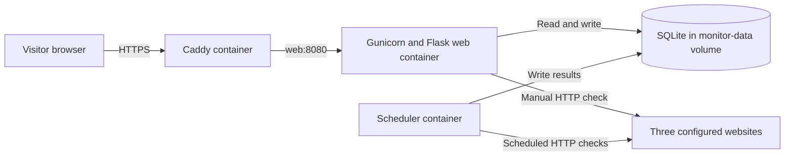

# Pulse project context

Last updated: 2026-11-27

Read this file when continuing work on Pulse. It records the current implementation, environment, learning preferences and exact continuation point. Use [PLANNING.md](PLANNING.md) for the roadmap and completion criteria, and inspect the actual code before changing behavior.

## Purpose and owner

Lihi Askapa is building a small DevOps portfolio and interview-preparation project. The application checks configured websites and records evidence about their availability. Learning to explain and operate the system is as important as adding features.

Work is AI-assisted and guided. Do not describe generated code or assisted steps as independent experience. Do not mix this personal project with Check Point work environments or customer information.

## Current state

| Area | Current state |
|---|---|
| Application | Flask app with a server-rendered dashboard and SQLite history. |
| Local containers | Web and optional scheduler, sharing one named data volume. |
| AWS deployment | Manually deployed on EC2, with Caddy providing public HTTPS. |
| CI | GitHub Actions tests Python code, builds the image and reruns tests in a container. |
| Tests | Ten test methods in `tests/test_app.py`. |
| CD | Not implemented. A GitHub push does not update AWS. |
| Terraform | CLI installed; initial provider configuration written locally. No init, plan, import or apply confirmed. |
| ECR and ECS | Planned; not configured for this project. |
| Latest recorded validation | User confirmed green CI and working public page, manual checks and cooldown blocking on 2026-11-26. This file is not a live health check. |

## Repository and environments

| Item | Value |
|---|---|
| Local repository on Mac | `/Users/lihias/Documents/Codex/mini-uptime-monitor` |
| GitHub repository | `https://github.com/lihi-askapa/mini-uptime-monitor` |
| Branch | `main` |
| Public demo | `https://pulse-13-60-191-46.sslip.io/` |
| Personal AWS account | `944464821297` |
| AWS region | `eu-north-1` — Stockholm |
| EC2 instance | `i-07451294bf374f84c`, named `mini-uptime-monitor` |
| Last confirmed public IP | `13.60.191.46` |
| EC2 operating system and size | Amazon Linux 2023, x86_64, t3.micro |
| Root disk | 16 GiB gp3, encrypted using `aws/ebs`; delete on termination enabled. |
| EC2 project directory | `/home/ec2-user/mini-uptime-monitor` |
| SSH key path on Mac | `~/.ssh/mini-uptime-monitor-key.pem`; never copy its contents into documentation or Git. |

The repository was created private. Confirm its current visibility before assuming portfolio visitors can read the code. The public application is separate from GitHub repository visibility.

SSH is restricted to Lihi's public source IP. That IP changed during the exercise and caused a connection timeout; updating the SSH source rule restored access. Recheck the current IP before changing the rule again. Ports 80 and 443 were opened for public web access.

The EC2 public IP may change after stop/start. Reconfirm it before copying commands or distributing the IP-based demo link. The last confirmed Free plan balance was an initial $100 credit allocation, not a current balance.

## Architecture

- `web` and `scheduler` use the same application image but different startup commands.
- `web` runs Gunicorn with one worker and four threads, listening on container port 8080.
- `scheduler` runs Flask's `monitor` CLI command, with a 60-second wait after each full round.
- Both mount `monitor-data` at `/app/data` and use `/app/data/checks.db`.
- Caddy reaches `web` over the Compose network. It does not read the application database.
- Public visitors connect to Caddy on port 443; HTTP on port 80 is redirected to HTTPS.
- Host port 8081 remains bound to loopback, not to all public interfaces.

## File responsibilities

Paths below are relative to the repository root.

| File | Responsibility |
|---|---|
| `app.py` | App factory, target configuration, database access, routes, shared check function and scheduler command. |
| `templates/index.html` | Render results and forms received from Flask; link to `/health`. |
| `static/style.css` | Dashboard presentation. |
| `requirements.txt` | Single dependency list: Flask 3.1.2 and Gunicorn 27.0.1. |
| `Dockerfile` | Python 3.12 image, dependency installation, code and tests, non-root user, Gunicorn and health check. |
| `.dockerignore` | Exclude local data and unrelated files from the build context. |
| `compose.yaml` | Base web service, optional scheduler, shared storage and local port mapping. |
| `compose.public.yaml` | Public overlay: public-demo mode, Caddy, certificate storage and restart policies. |
| `Caddyfile` | Public hostname, HTTPS handling, response headers and reverse proxy to `web:8080`. |
| `tests/test_app.py` | Ten automated tests with temporary databases and mocked HTTP responses. |
| `.github/workflows/ci.yml` | CI triggers and test/build steps; no deployment job. |
| `.gitignore` | Keep databases, environment files, Terraform state, downloaded providers and wheel cache out of Git. |
| `.env.example` | Configuration reference; Flask does not load it automatically. |
| `wheelhouse/` | Optional ignored local offline-install cache; Git tracks only its placeholder. |
| `infra/terraform/main.tf` | Initial Terraform/provider requirements, AWS region and permitted account. |
| `docs/PLANNING.md` | Completed phases, next stages and completion criteria. |
| `docs/CONTEXT.md` | Current system context and continuation point. |
| Other files in `docs/` | Learning history and Docker, CI and public-demo guides. |

`requirements-container.txt` was intentionally deleted when dependencies were unified. Do not reintroduce it accidentally.

## Application behavior

Configured targets:

| ID | URL |
|---|---|
| `example` | `https://example.com` |
| `portfolio` | `https://lihi-portfolio-site.onrender.com/` |
| `ogdan` | `https://ogdan-mehandesim.onrender.com/` |

`GET /` reads the latest result for each target and the most recent 50 checks. Refreshing the page does not initiate an external website check. Older database rows remain stored without a retention limit.

`POST /checks` accepts a configured target ID. Python's HTTP client follows redirects and measures time until response headers are available, not full page load or JavaScript behavior. HTTP 200–399 is up; other HTTP codes and connection failures are down. The configured five-second timeout is a socket timeout, not a strict total deadline.

The scheduler reuses `check_target`. It checks targets sequentially, waits 60 seconds after the round and repeats. Logs contain a start line, three result lines and an end line per round. Only results are stored as check rows. Refresh the dashboard to see new scheduled results.

`GET /health` checks whether the application can read the checks table. Success returns 200; a database error returns 503. It does not verify database writes, target availability or scheduler liveness. The App health link and Docker health check use this route.

SQLite is the embedded database engine; `sqlite3` is its Python interface; `checks.db` is the data file. The database contains `checks` and `manual_check_limits`. A Docker volume survives container replacement but is not a backup and does not survive deleting its underlying storage.

## Public-demo behavior

The public overlay sets `PUBLIC_DEMO=1` for web. Forms require a session token, and cookies are Secure and HttpOnly. HTTP access through the earlier SSH tunnel can display the page, but public-mode form cookies require HTTPS.

Manual checks have a shared per-target 30-second cooldown recorded in SQLite. A repeated request receives 429 and a `Retry-After` header. A SQLite transaction reserves the slot before the outbound request. This does not stop the scheduler or make this a DDoS-protected service.

The application generates a session-signing key on startup unless `SECRET_KEY` is supplied. Keep the current single Gunicorn worker assumption; after a key change, visitors may need to reload the page. Multi-worker or multi-host deployment requires a deliberate shared-secret and storage configuration.

## Test inventory

The suite grew from five to seven to ten tests as features were added. Notify Lihi before adding, removing or changing tests.

1. Successful checks persist across application restart.
2. HTTP errors record their code without marking the monitoring application unhealthy.
3. Connection errors record no HTTP status.
4. Unknown targets are rejected without an outbound request.
5. Database failure makes `/health` return 503.
6. One scheduler round checks and saves every configured target.
7. Scheduler intervals shorter than ten seconds are rejected.
8. Public manual requests without the form token are rejected.
9. The public cooldown is shared across visitors and expires.
10. The scheduler works in public-demo mode without a form token.

The database-failure test intentionally logs an error. The test succeeds when the expected 503 is returned; look for `ok` and the final summary rather than treating every ERROR log as a failed test. These tests do not constitute a full multi-container integration or load test.

## Build and deployment context

On the Mac, ordinary dependency downloads previously failed with a TLS problem. The documented fallback is an offline build using local wheels. That cache targets Linux ARM64 and is not in Git. Do not transfer it as an x86 EC2 installation solution.

The EC2 host and CI successfully built online. The current manual release process is: commit code, create a Git archive on the Mac, copy it with SCP, extract it on EC2, build an image, run its tests and update services. Archiving `HEAD` includes committed files only; SCP alone does not deploy anything.

Public deployment uses both Compose files and the `monitoring` profile. Supply the hostname when invoking it. There are three named volumes: application data, Caddy data and Caddy configuration. Preserve them during routine updates.

Reference commands below are for orientation, not instructions to execute all at once:

| Environment | Command | Effect |
|---|---|---|
| Mac, repo root | `terraform version` | Read installed Terraform version. |
| Mac, repo root | `python3 -m unittest discover -s tests -v` | Run tests with available local dependencies. Use Python 3.12 for a fresh full dependency installation. |
| Mac, repo root | `docker compose build --build-arg OFFLINE_INSTALL=1` | Build using the local wheel cache. |
| EC2, repo root | `sudo docker build -t mini-uptime-monitor:local .` | Build online; does not replace running containers. |
| EC2, repo root | `sudo docker run --rm mini-uptime-monitor:local python -m unittest discover -s tests -v` | Test in a temporary container without mounting live application data. |
| EC2, repo root | `sudo env DEMO_DOMAIN=pulse-13-60-191-46.sslip.io docker compose -f compose.yaml -f compose.public.yaml --profile monitoring ps` | Inspect the public stack. |

For public update commands and troubleshooting, use [public-demo.md](public-demo.md). Do not run `down -v` as a routine deployment step: it removes named volumes.

## Current continuation point

Terraform 1.17.2 was installed with Homebrew, and the user verified its version on the Mac. The `infra/terraform` directory exists and `main.tf` was written. Its format check passed. It permits AWS provider 6.x and only the personal account listed above.

The last instruction was to run `cd infra/terraform` from the local repository root. The user has not yet confirmed that directory change. No provider download, Terraform state, AWS authentication, cloud plan, import or apply has been confirmed. The earlier IAM-role/CD walkthrough was interrupted before any role creation was confirmed.

The immediate next learning step is to read `main.tf` together, confirm the local working directory and explain `terraform init` before asking the user to run it. Infrastructure ownership and authentication must be decided before cloud changes. Continue toward Terraform, ECR and controlled CD; study ECS and AI plugins as described in the plan.

Before this documentation change, `infra/terraform/main.tf` was the local untracked addition and the latest repository commit was `3128557`. Recheck `git status` and history on continuation rather than treating this snapshot as live Git state. The documentation commit includes these two documents and their README links; the Terraform configuration is excluded from that commit pending its walkthrough.

## Teaching and collaboration preferences

- Speak to Lihi in Hebrew, with short explanations and minimal mixing of Hebrew and English on the same line. These planning and context files are intentionally English Markdown.
- Give one command at a time. State where it runs: Mac shell, EC2 shell, inside Codex or inside a container.
- Explain the command's parts, purpose and expected output. Say whether it reads, installs, changes files or modifies cloud resources.
- Review the result before progressing. A local prompt contains `lihias@...`; the EC2 prompt contains `ec2-user@ip-172-31-47-73`.
- Announce every intended code/configuration change before editing, and summarize what changed and how it was verified afterward. State test-count changes explicitly.
- Preserve the learning pace. Do not silently build a large next stage or repeatedly quiz concepts after the user asks to move on.
- Keep account credentials, SSH keys, tokens, Terraform state and private work/customer data out of Git and chat output.

## Local AI tools

Herdr 0.9.5 and Claude Code 2.1.326 were installed on the Mac. A local `codex` launcher invokes the CLI bundled with the desktop application. Herdr integrations for both agents were configured, with backups of earlier configuration saved locally.

Herdr organizes terminals and agent sessions; it does not change the deployed application. Lihi resumed this conversation in the terminal. An observed read-only message meant the same conversation was open in another application, not that the project files lacked write permissions.

Keep this setup separate from the project's runtime architecture. Do not assume Claude account authentication or arbitrary tool availability is complete merely because the executable is installed.

## Keeping context current

After a meaningful milestone, update the affected status, configuration, test count and continuation point. Record the date and distinguish local checks, CI results and user-confirmed server behavior. Keep historical investigations in the learning notes and planned changes in the planning document. Never turn these documents into a store for secrets or claim unverified work as complete.
