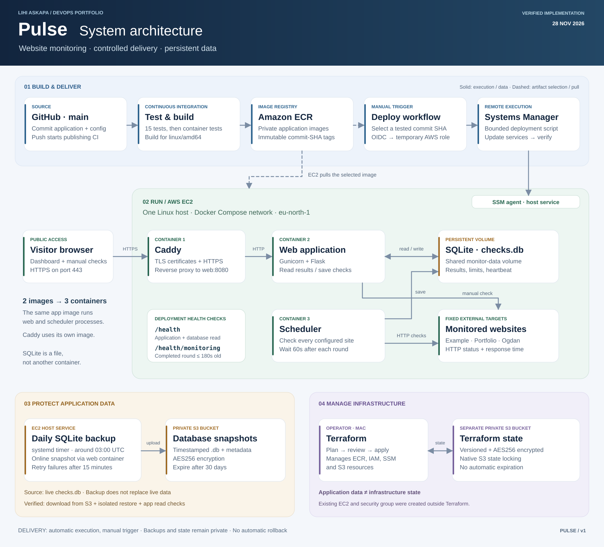

# Pulse — system architecture

One EC2 host runs a public website monitor with controlled deployments, persistent
history and daily backups. The diagram describes the implemented v1 system.

[Open the full-size diagram](assets/architecture.svg) · [PNG download](assets/architecture.png)

## Four flows

| Flow | What happens |
|---|---|
| **Visitor request** | Caddy accepts HTTPS and forwards to Gunicorn/Flask. The dashboard reads SQLite; a manual check queries a configured website and saves the result. |
| **Scheduled monitoring** | A separate process uses the same application image and database volume. It checks all three websites, records results and a completed-round heartbeat, then waits 60 seconds. |
| **Build and deployment** | GitHub CI runs 15 tests, builds an amd64 image, reruns the tests in it and publishes a commit-SHA tag to ECR. A manually triggered workflow uses OIDC and SSM to deploy the selected tested image. |
| **Data protection** | A systemd timer creates an online SQLite snapshot and uploads it to private encrypted S3 storage daily, with 30-day expiration. Terraform uses a separate private, versioned S3 state bucket with locking and no expiration. |

## The distinctions that matter

- **Two runtime images, three containers:** the application image runs both web and
  scheduler; Caddy has its own image. SQLite is a shared file, not a container.
- **Health is specific:** `/health` checks application/database readability;
  `/health/monitoring` requires a completed scheduled round within 180 seconds.
  Target HTTP availability does not prove that every website feature works.
- **Publishing is not deployment:** pushes publish tested images. An operator
  explicitly starts deployment; the script verifies image IDs, public health and
  a newly completed scheduled round.

## Verified recovery and current scope

Deployment and return to a previous compatible image succeeded through GitHub
Actions. A stopped scheduler produced 503 and recovered to 200 after restart.
An S3 backup was downloaded and restored into a separate database; integrity,
contents and application reads passed. Concurrent Terraform plans were blocked
by the state lock.

This is a single-host demo. EC2 itself was created outside Terraform. Automatic
alerts, automatic rollback, schema-migration recovery and ECS are future work.

[Deployment](deployment.md) · [Backup and restore](backup-restore.md) ·
[Terraform state](terraform-state.md) · [Roadmap](PLANNING.md)
